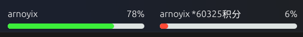
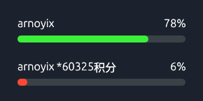
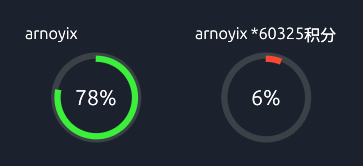
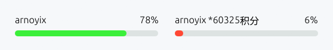

# QuotaMonitor

轻量的桌面悬浮额度监视器，用于查看多个 Codex 账号的剩余额度、积分和重置卡。中文界面，支持横条、圆环、拖动定位与系统托盘。

[下载最新版](https://github.com/ArnoYixi/QuotaMonitor/releases/latest) · [报告问题](https://github.com/ArnoYixi/QuotaMonitor/issues) · [参与开发](CONTRIBUTING.md)

本项目由社区独立开发，与 OpenAI 无隶属或背书关系。额度和可用功能以账号实际返回的数据为准。

## 界面预览

实际使用截图：两个账号均命名为 `arnoyix`，剩余额度分别为 **78%** 和 **6%**，第二个账号显示 **60325 积分**。



下面的参考图由程序的实际界面组件渲染，固定使用上图的数据，用于展示不同布局和外观，不表示实时额度。

| 纵向横条 | 横向圆环 |
| --- | --- |
|  |  |

浅色背景：



## 功能

- **多账号监测**：独立登录、改名、排序、隐藏或暂停监测；在详情页查看各额度周期和恢复时间。
- **桌面悬浮**：横条与圆环两种样式，支持缩放、置顶和拖动。靠近顶部或底部时横向排列，靠近左右边缘时纵向排列。
- **自适应外观**：Windows 下根据背景调整文字颜色；复杂背景下自动添加柔和衬底，纯色背景保持透明。
- **托盘控制**：显示、隐藏、刷新、设置、锁定与退出。锁定后悬浮窗穿透鼠标，托盘仍可直接解锁和退出。
- **积分与重置卡**：积分向上取整，不显示小数。重置操作需手动触发，并优先选择最早到期的可用卡。
- **本地运行**：Rust + egui 原生程序；Windows 发布包包含所需登录组件，无需另装 Python、Node.js 或 Codex CLI。

## 下载与使用

1. 在 [Releases](https://github.com/ArnoYixi/QuotaMonitor/releases) 下载 `QuotaMonitor-v版本号-windows-x64.zip`。
2. 解压到固定目录，双击 `QuotaMonitor.exe`。
3. 选择添加账号，在官方登录页面完成登录。可依次添加多个账号，登录时确认浏览器使用的是目标账号。
4. 拖动账号名或进度图形调整位置；右键悬浮窗，选择“打开菜单”管理账号和外观。

Windows 发布包面向 Windows 10 / 11 x64，需要支持 OpenGL 的图形驱动。程序尚未进行代码签名。

### 常用操作

| 操作 | 方法 |
| --- | --- |
| 切换横条 / 圆环、刷新间隔、缩放 | 打开菜单 → 设置 |
| 查看各周期、恢复时间、积分明细 | 打开菜单 → 管理账号 → 详情 |
| 锁定悬浮窗 | 右键悬浮窗或托盘图标 → 锁定悬浮 |
| 解锁悬浮窗 | **右键系统托盘图标 → 解锁悬浮** |
| 隐藏 / 恢复窗口 | 使用托盘菜单；左键托盘图标可显示窗口 |
| 完全退出 | 托盘菜单 → 退出 |

锁定后，悬浮窗本身不接收鼠标操作。解锁立即生效，无需先隐藏再显示；左键托盘图标只显示窗口，不会解除锁定。关闭设置窗口会留在托盘，没有可用托盘时则退出。

### 无需登录体验

运行发布包中的 `Demo.bat`，或：

```powershell
.\QuotaMonitor.exe --demo
```

演示模式使用独立的模拟数据，不会登录账号或消耗重置卡；其动态演示数据与 README 的固定参考图不同。

## 数据与隐私

- 通过官方 Codex App Server 获取账号信息与额度，不要求粘贴 Cookie 或 API Key。某个账号不支持的字段会显示为空或不可用；请求失败时保留缓存并标明状态。
- 登录凭据交由官方组件及操作系统凭据库管理。可在设置中选择仅本次会话登录。
- 设置、额度缓存和重置操作记录保存在本机。Windows 新安装的数据目录通常为 `%LOCALAPPDATA%\ArnoYixi\QuotaMonitor\data`；也可用 `--data-dir <目录>` 指定位置。
- 从旧版 QuotaMonitori 升级时，会继续使用已有旧目录，保留账号与设置。已有开机启动项会更新为新程序路径。
- 背景自适应只读取窗口周围少量颜色点，不保存或上传屏幕图像。
- 重置卡属于账号资源；请在确认后手动使用。操作结果不明确时程序会先核对记录，避免重复提交。

## 从源码构建

构建环境：Rust 1.99.0；Windows 还需 Visual Studio C++ Build Tools 和 Windows SDK。Python 3 仅用于构建时下载组件与收集许可证。

```powershell
git clone https://github.com/ArnoYixi/QuotaMonitor.git
cd QuotaMonitor
rustup toolchain install 1.99.0 --profile minimal --component rustfmt
rustup override set 1.99.0
.\scripts\build-windows.ps1
```

输出位于 `dist/`。构建脚本会下载并校验固定版本的官方组件，版本与 SHA-256 记录在 `scripts/fetch_runtime.py` 和 `build.rs`。

运行 `scripts/package-windows.ps1` 可进行内置组件自检并生成 ZIP 和校验和，输出位于 `dist/releases/v<版本>/`。

Linux 源码构建：

```bash
sudo apt-get install libgtk-3-dev libayatana-appindicator3-dev libxdo-dev libxkbcommon-dev libssl-dev
./scripts/build-linux.sh
```

Linux 的托盘、定位和窗口行为依赖桌面环境；Wayland 尤其受合成器限制。当前 Release 提供 Windows x64 包。

开发调试与测试：

```powershell
cargo run --locked -- --demo
cargo fmt --check
cargo test --all-targets --locked
```

不打包官方组件的开发版本可在设置中指定本机 Codex CLI 路径。更多回归步骤见 [验收说明](docs/ACCEPTANCE.md)。

## 反馈与贡献

欢迎在 [Issues](https://github.com/ArnoYixi/QuotaMonitor/issues) 反馈问题或提出建议。请附系统版本、程序版本、复现步骤和已脱敏截图；不要提交账号凭据、Token 或完整个人数据目录。开发说明见 [CONTRIBUTING.md](CONTRIBUTING.md)。

## 许可证

项目源码采用 [MIT License](LICENSE)。随包分发的官方 Codex 组件采用 Apache-2.0，字体采用 SIL Open Font License；其他依赖详见 [第三方声明](THIRD-PARTY-NOTICES.md) 和发布包中的 `licenses/`。
